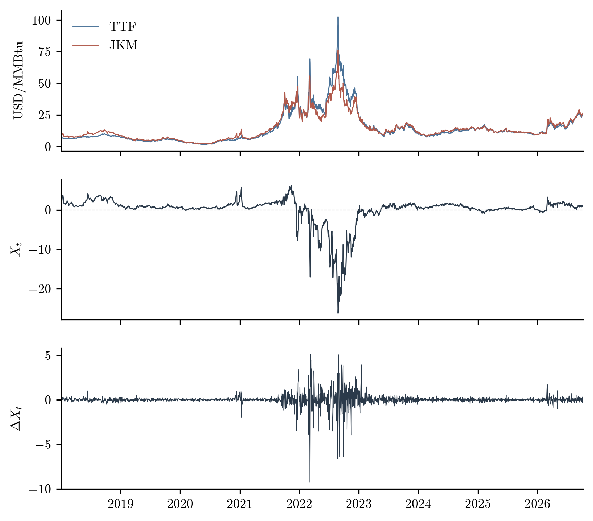
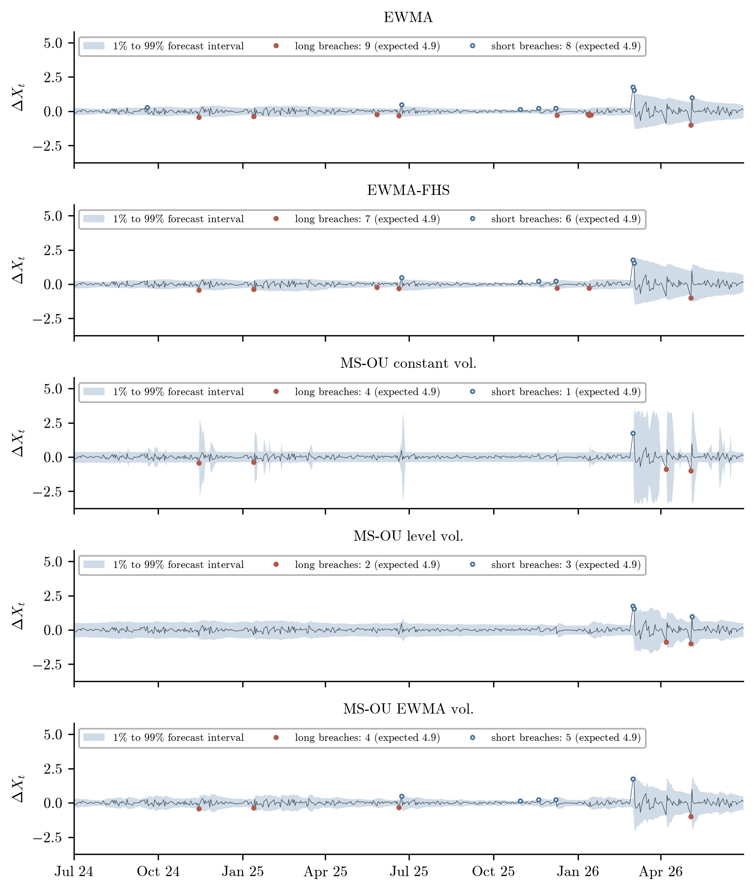
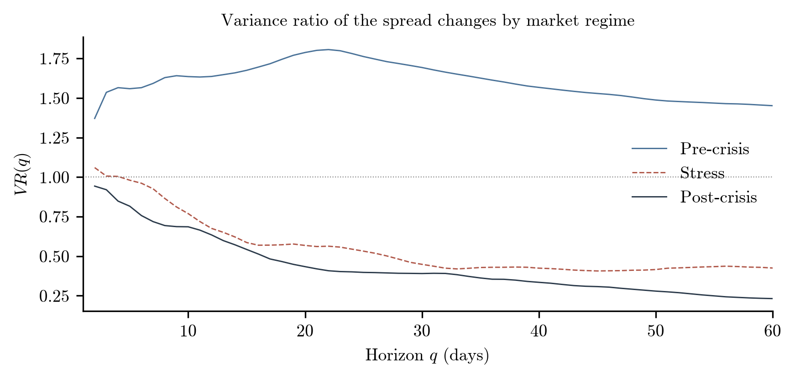
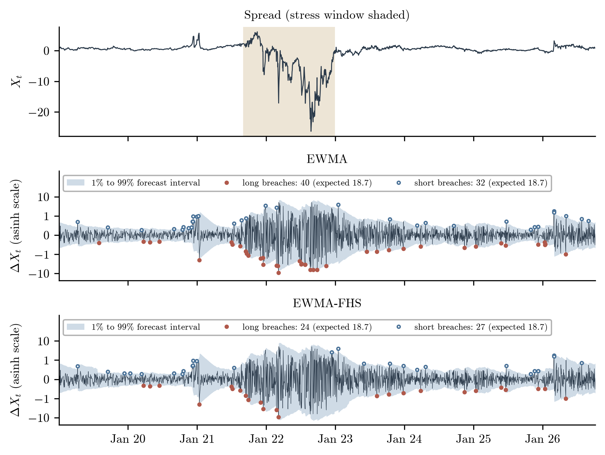

# Conditional VaR on the JKM − TTF LNG Spread

**Adaptive Models and Markov-Switching Ornstein-Uhlenbeck Processes: An Empirical Benchmark, 2019 – 2026**

[](https://www.python.org/)
[](tests/)

## Contents

[Abstract](#abstract) · [Context](#context) · [Models](#models) · [Results](#results) · [Implementation](#implementation-highlights) · [Pipeline](#pipeline) · [Reproducing](#reproducing-the-benchmark) · [Limitations](#data-and-limitations) · [Appendices](#appendices)

## Abstract

The project looks at five ways to forecast 1-day Value-at-Risk (VaR) on the spread between Asian liquefied natural gas (JKM) and European natural gas (TTF). Two of them are standard adaptive benchmarks (RiskMetrics EWMA and Filtered Historical Simulation). The other three are Markov-Switching Ornstein-Uhlenbeck (MS-OU) models, which allow mean reversion to turn on and off with the market state. Daily settlement prices come from [Databento](https://databento.com), and both legs of the spread use the same delivery month to avoid roll bias.

How much the spread pulls back to a level changes with the market. In the calm years after the crisis it pulls back hard (two-week half-life). When prices trend, it does not pull back at all. During the crisis no test can pick the effect up. The out-of-sample record spans 1,867 trading days, including the 2022 European energy crisis. On its own, the structural model does not beat the adaptive ones — the two together do. The winning model puts an EWMA volatility filter inside an MS-OU, and lets the mean-reverting drift run only in the calm regime. No coverage test rejects it, and its quantile tick loss at the 1% long VaR is 18% below EWMA. The improvement over EWMA-FHS is significant; over EWMA it falls just short of the 5% line.

The full method (math, tests, detailed results and references) is in [`docs/methodology.md`](docs/methodology.md).

## Context

JKM (Japan Korea Marker, Platts) is the price of LNG delivered to Northeast Asia. TTF (ICE Endex) is the European benchmark. Their spread, in USD/MMBtu, is the arbitrage between the two sides of the market. Shipping and regasification costs usually keep it within limits, but not always. Between 2019 and 2026 the spread moves from calm, to an Asian squeeze (+5.7 USD/MMBtu in January 2021), to the 2022 European gas crisis (−26 USD/MMBtu). Daily volatility rises by a factor of 17 along the way.

<p align="center"></p>

The question this project asks: for a long or short position in an energy spread, does a structural mean-reverting regime-switching model (MS-OU) forecast 1-day VaR better than the standard adaptive models? And does putting the two together buy anything measurable?

## Models

### Setup

Both legs use the same delivery month (USD/MMBtu). On day $`t-1`$, a model gives the distribution of the spread's next daily change and the quantiles $`q_t(p)`$ at $`p \in \{1\%, 5\%, 95\%, 99\%\}`$:

```math
X_t = S^{JKM}_t - S^{TTF}_t, \qquad \Delta X_t = X_t - X_{t-1}
```

Directional VaR at level $`\alpha \in \{1\%, 5\%\}`$ comes from these quantiles. A long position loses when the spread collapses ($`\Delta X_t < 0`$), a short position when it spikes ($`\Delta X_t > 0`$):

```math
\text{VaR}^L_t(\alpha) = -q_t(\alpha), \qquad \text{VaR}^S_t(\alpha) = q_t(1 - \alpha)
```

### Adaptive benchmarks (single regime, zero drift)

Both follow the RiskMetrics exponentially weighted variance, with $`\lambda = 0.94`$:

```math
\hat{\sigma}_t^2 = \lambda \, \hat{\sigma}_{t-1}^2 + (1 - \lambda)(\Delta X_{t-1})^2
```

- **EWMA**: Gaussian shocks, $`q_t(p) = \Phi^{-1}(p) \, \hat{\sigma}_t`$.
- **EWMA-FHS** (Filtered Historical Simulation): instead of the Gaussian quantile, use the empirical quantile $`\hat{Q}_p`$ of the standardized residuals $`\epsilon_\tau = \Delta X_\tau / \hat{\sigma}_\tau`$ over a rolling 250-day window:

```math
q_t(p) = \hat{\sigma}_t \cdot \hat{Q}_p\left( \{\epsilon_\tau\}_{\tau = t-250}^{t-1} \right)
```

### Markov-switching Ornstein-Uhlenbeck (MS-OU)

A hidden regime $`S_t \in \{1, 2\}`$ (calm, turbulent) drives the spread. Inside each regime the spread follows an OU process that pulls it back to a level $`\mu_s`$ at speed $`\theta_s`$:

```math
dX_t = \theta_s(\mu_s - X_t)\,dt + \sigma_s\,dW_t
```

Over one day this gives the exact discrete-time dynamics: a mean-reverting drift plus a scaled shock.

```math
\Delta X_t = m_{s,t} + c_{s,t} \, \epsilon_t, \qquad m_{s,t} = (1 - e^{-\theta_s})(\mu_s - X_{t-1}), \qquad \epsilon_t \overset{\text{i.i.d.}}{\sim} \mathcal{D}(0, 1)
```

Each day the Hamilton filter gives the regime probabilities $`\xi_{t|t-1}(s) = \mathbb{P}(S_t = s \mid \mathcal{F}_{t-1})`$. The forecast distribution is the mix of the two regimes; quantiles come from inverting its CDF by computer:

```math
F_t(x) = \sum_{s=1}^{2} \xi_{t|t-1}(s) \, F_{\mathcal{D}}\left(\frac{x - m_{s,t}}{c_{s,t}}\right), \qquad q_t(p) = F_t^{-1}(p)
```

A regime keeps its mean-reverting drift only if sequential likelihood ratio tests ($`\chi^2(2)`$) find it significant. Otherwise the regime drifts like a random walk ($`\theta_s = 0`$), which keeps the fit from overfitting at the boundary.

All five models forecast $`\Delta X_t = m_{s,t} + c_{s,t}\,\epsilon_t`$: a drift $`m`$ (mean reversion), a volatility scale $`c`$ and a random shock $`\epsilon`$. The only difference is how each piece is built:

| Model | Regimes | Mean reversion ($`m`$) | Volatility ($`c`$) | Shocks ($`\epsilon`$) |
|---|---|---|---|---|
| **EWMA** | 1 | None | $`\hat{\sigma}_t`$, the EWMA volatility | Normal |
| **EWMA-FHS** | 1 | None | $`\hat{\sigma}_t`$, the EWMA volatility | Observed over the last 250 days |
| **Constant-vol MS-OU** | 2 | Calm regime only | Fixed level in each regime | Normal |
| **Level-dependent MS-OU** | 2 | Turbulent regime only | $`k_s \, L_{t-1}`$, proportional to the average price level $`L_{t-1}`$ | Student-$`t`$ (fat tails) |
| **EWMA-vol MS-OU** (hybrid) | 2 | Calm regime only | $`k_s \, \hat{\sigma}_t`$, the EWMA volatility times a regime multiplier | Normal |

The first two are the adaptive benchmarks. The three MS-OU models switch between calm and turbulent states. The hybrid puts the adaptive volatility of EWMA together with the switching mean reversion of MS-OU, and it wins the benchmark. The exact scale of the constant-vol model and the level $`L_t`$ are defined in [`docs/methodology.md`](docs/methodology.md).

### Scoring

Coverage is checked with the Kupiec and Christoffersen tests (how often the VaR is breached, and whether breaches are independent). Accuracy is measured with the asymmetric quantile tick loss, which reaches its minimum at the true quantile. Models are compared with Diebold–Mariano tests (Newey–West HAC variance):

```math
L_t(p) = \left(p - \mathbb{1}\left\{\Delta X_t < q_t(p)\right\}\right)\left(\Delta X_t - q_t(p)\right)
```

## Results

### Benchmark synthesis

<p align="center"></p>

In (a), the points are observed breach rates and the shaded bands are the Kupiec 5% acceptance regions. Hollow circles mean that no coverage test rejects (Kupiec unconditional, independence, or conditional coverage). In (b), the bars show mean tick loss relative to EWMA. Fill in dark means the Diebold–Mariano difference is significant at 5%; fill in light means it is not.

| Model | 1% Breaches, Long / Short (18.7 expected) | Rejected Cases (Kupiec or Christoffersen, out of 4) | Tick Loss vs EWMA, Long / Short at 1% |
|---|---:|---:|---:|
| EWMA | 40 / 32 | 3 | Benchmark |
| EWMA-FHS | 24 / 27 | 1 | −3% / +2% |
| Constant-volatility MS-OU | 39 / 38 | 4 | +43% / +76% |
| Level-dependent MS-OU | 20 / 22 | 3 | −13% / +8% |
| EWMA-volatility MS-OU | 18 / 19 | 0 | −18% / +5% |

- EWMA-volatility MS-OU is the only model no coverage test rejects. It puts out 18 long and 19 short breaches at 1%, against 18.7 expected. Its quantile loss is the lowest of the five for 1% long (−18%) and 5% short (−3%) positions, and it pays a small price (+5%) at 1% short. Its lead over EWMA-FHS on the 1% long VaR is significant (Diebold–Mariano $`p = 0.009`$, and it also holds up under the Bonferroni correction). Against EWMA the lead does not quite reach significance ($`p = 0.052`$ at 1%, $`p = 0.063`$ at 5%).
- The mean-reverting drift it keeps in the calm regime, by the LR rule, is significant in-sample but slow (74-day half-life). Most of the gain follows from the volatility regime switching, which fattens the tails of the forecast mixture.
- Constant-volatility MS-OU fails all four test cases and is significantly worse than EWMA. Level-dependent MS-OU shows clustered breaches, because its volatility scaling moves with the cycle. The stress window takes up 18% of trading days but 43% to 76% of total cumulative tick loss.

### Backtest dynamics and VaR breaches

The daily out-of-sample paths show how each model reacts to volatility shocks, and where the breaches fall (1% and 99% levels).

<p align="center"></p>

Over July 2024 – June 2026 (490 trading days, so 4.9 expected breaches per tail), EWMA-volatility MS-OU records 4 long and 5 short breaches at 1%. That is the closest to target of the five models. EWMA nearly doubles the expected count (9 long, 8 short). EWMA-FHS also overshoots (7 and 6). Both carry a single Gaussian or empirical scale, so their bands are too narrow on ordinary days. The hybrid keeps its band tight in quiet months thanks to the calm regime, then widens it right after the March 2026 jump. Its combined 1% tick loss over the window is also the lowest (−5.5% against EWMA, −6.1% against EWMA-FHS). Constant-volatility MS-OU only flips between two fixed bands, and level-dependent MS-OU stays too wide (2 long, 3 short breaches).

<p align="center"></p>

Over the full 1,867-day window (2019–2026), cumulative breaches of EWMA-volatility MS-OU stay inside the 95% binomial acceptance interval under $`H_0`$ for the whole history, in both directions. EWMA breaches cross the theoretical bounds on both sides, with rates above 1% for most of the post-crisis period. EWMA-FHS stays inside for long positions.

### Stress test: the 2021–2022 European energy crisis

<p align="center"></p>

During the European energy crisis (September 2021 – December 2022), EWMA records 18 long 1% breaches against 3.3 expected. Its band widens only after each shock lands (Sep/Dec 2021, Feb/Mar, Jun/Jul, Aug/Sep, Nov 2022). EWMA-FHS is the only model not rejected in any of the four cases during the crisis, because its empirical left tail grew after the 2021 shocks. EWMA-volatility MS-OU is too narrow on the long side (10 breaches) and too conservative on the short side (zero). Outside the crisis, though, it is the only model never rejected.

## Implementation Highlights

- State-dependent mean reversion: tested on pre-crisis, crisis and post-crisis regimes with ADF (BIC lag selection) and Lo-MacKinlay heteroskedasticity-robust variance ratios.
- In-sample specification protocol: MS-OU regime drifts are fixed before any forecasting, using sequential likelihood ratio tests ($`\chi^2(2)`$), with a scale ordering ($`r \ge 1`$) that rules out label switching.
- Constant-delivery-month spread: built across the first three TTF and first two JKM CME maturities. This removes artificial calendar roll jumps without skipping any trading session.
- Stale session filter: a session where a held contract settles at exactly the same price as the day before (Platts holidays in London or Singapore) is dropped, and the two-day difference is taken across the holiday gap.
- Hand-written Hamilton filter: written from scratch so it can take level-dependent and EWMA scale regressors, and Student-$`t`$ mixtures — things standard econometric packages do not offer. It matches `statsmodels.MarkovRegression` exactly on the Gaussian baselines.
- Strict out-of-sample protocol: monthly walk-forward recalibration on expanding windows (94 recalibrations per model, run in parallel with `concurrent.futures`), daily recursive filtering, and exact mixture quantile inversion with Brent's method.
- Statistical backtesting: Kupiec unconditional coverage, Christoffersen Markov independence and joint conditional coverage, tick loss, and Diebold–Mariano tests with Newey–West HAC variance.
- Test suite: 23 unit tests (`pytest`) that check each econometric module against analytical results, reference packages and controlled Monte Carlo runs.

## Pipeline

| Step | Script | What it does |
|---|---|---|
| 0 | `00_download_databento.py` | Downloads CME settlements (TTF, JKM) from [Databento](https://databento.com) and the EUR/USD rate from the ECB |
| 1 | [`01_data_analysis.py`](01_data_analysis.py) | Builds the constant-delivery-month spread. Daily changes are the return on contracts actually held, so roll jumps never enter the series. Stale sessions (Platts holidays) are dropped |
| 2 | [`02_stationarity.py`](02_stationarity.py) | ADF, KPSS and variance ratio tests before, during and after the crisis. The post-2023 regime is stationary (ADF $`p = 0.001`$, 14-day half-life, 20-day variance ratio at 43% of a random walk). On the full sample, regime shifts hide the mean reversion |
| 3 | [`03_var_models.py`](03_var_models.py) | Five models, one-step-ahead densities out of sample. Maximum likelihood, recalibrated monthly, drift chosen by likelihood ratio tests. Density calibration checked with the PIT |
| 4 | [`04_backtest.py`](04_backtest.py) | Kupiec and Christoffersen tests, tick loss, Diebold–Mariano tests. Full sample, stress and non-stress periods |

## Reproducing the Benchmark

Tested on Python 3.12. The full pipeline runs in about two minutes, once the data is in.

> **Data Download**: CME licensing rules mean no market data is versioned here (`data/` is empty on clone). `00_download_databento.py` pulls daily settlement prices for TTF and JKM futures from the **[Databento](https://databento.com)** API (key in `DATABENTO_API_KEY` or a `.env` file; cost ≈ 0.05 USD; `pip install databento`) and the EUR/USD reference rate from the free [ECB Data Portal](https://data.ecb.europa.eu/) API. The sample stops at 2026-10-07 (`END` in `common.py`), so a later download reproduces the published results exactly.

```bash
pip install -r requirements.txt
pytest                            # 23 unit tests (runs on synthetic data, no API key needed)

# Optional: download raw data and regenerate the entire benchmark
cp .env.example .env              # Set your DATABENTO_API_KEY
python 00_download_databento.py   # Download TTF/JKM (Databento, API key required) and EUR/USD (ECB, free)
python 01_data_analysis.py        # Build constant-delivery spread and summary moments
python 02_stationarity.py         # Regime-dependent unit root and variance ratio tests
python 03_var_models.py           # Out-of-sample walk-forward VaR forecasts (≈ 2 min)
python 04_backtest.py             # Backtests, coverage tables, tick loss, and figures
```

```text
├── data/             Created by scripts 00 and 01 (not versioned): settlements, EUR/USD, and spread.csv
├── results/          Out-of-sample model forecasts and backtest evaluation tables
├── figures/          High-resolution PNG figures (organized by phase)
├── docs/             methodology.md: detailed mathematical derivations, test tables, and references
├── tests/            Pytest unit test suite
├── common.py         Shared paths, chart styling, and data loading utilities
└── 0*_*.py           Phase execution scripts
```

## Data and Limitations

- Databento settlement data: daily settlements for CME Dutch TTF (EUR/MWh, identical to ICE Endex within the CME tick size) and CME JKM (Platts, USD/MMBtu), downloaded from [Databento](https://databento.com) with `00_download_databento.py`, plus the [ECB](https://data.ecb.europa.eu/) EUR/USD reference fixing from 2018-01-02 to 2026-10-07. 2018 is only a warm-up year.
- The spread uses delivery months 2 to 3 months forward. A prompt-month spread would lose its volatility as expiry nears, because of the Platts pricing window.
- The stale quote filter drops 101 sessions (4.6%). A few of them are real zero price moves. The ECB rate is fixed at 14:15 CET, before the afternoon settlements.
- The specification rules (drift selection, constant delivery month) come from full-sample econometric work. Only model parameters are strictly walk-forward.
- The empirical conclusions stand on one major energy crisis (328 trading days). A natural next step for regulation would be the 97.5% Expected Shortfall under FRTB.

---

## Appendices

Extra figures, by project phase. Full tables and test output are in [`docs/methodology.md`](docs/methodology.md).

### A.1 Calendar rolls and constant-delivery-month construction

<p align="center"></p>

A chained front-month series rolls from contract to contract (a). On each roll date the calendar spread between the two contracts adds an artificial jump. In calm periods all ten of the largest daily moves in the chained front-month spread fall on a roll day (b), and JKM rolls are 56% of total squared changes in 2019–2020. The constant-delivery-month construction (c) removes those jumps without dropping any trading day, and daily standard deviation falls from 0.24 to 0.09 USD/MMBtu.

### A.2 The spread across market regimes

<p align="center"></p>

Spread levels and volatility look nothing alike across regimes. Daily standard deviation is 0.10 in 2019 and 1.76 in 2022. The spread reaches +5.7 during the Asian squeeze and −26 during the European crisis.

### A.3 Distribution and time-series properties of spread changes

<p align="center"></p>

The tails are very heavy over the full sample: a Student-$`t`$ fit gives $`\hat\nu \approx 1.1`$, which mostly reflects the unconditional mix of volatility regimes. Raw changes barely autocorrelate ($`+0.056`$ at lag 1). Squared changes stay autocorrelated over the first 9 lags, the usual sign of strong volatility clustering.

### A.4 State-dependent mean reversion

<p align="center"></p>

The Lo-MacKinlay variance ratio compares the variance of $`q`$-day changes with $`q`$ times the daily variance. It is 1 for a random walk and below 1 under mean reversion. Post-crisis it falls to 0.43 at 20 days ($`p = 0.049`$). Pre-crisis it goes above 1.5, which points to trending behaviour. During the crisis the extreme volatility removes most of the test's power.

<p align="center"></p>

Estimated on 250-day rolling windows, the Ornstein-Uhlenbeck equilibrium level $`\hat\mu`$ moves between persistent plateaus: +0.3 to +1.3 in 2019–2020, −9.9 to −5.2 from Sep 2022 to Jun 2023, and +0.1 to +1.1 since 2024.

### A.5 Out-of-sample regime classification

<p align="center"></p>

Constant-volatility MS-OU picks up the stress regime in autumn 2021 and stays there for 95% of 2022. Regime 2 of level-dependent MS-OU reacts to volatility relative to price levels: it covers half of 2020, when prices hit all-time lows, and two-thirds of 2022.

### A.6 Predictive density calibration (PIT)

<p align="center"></p>

A well-calibrated density spreads realised changes uniformly across forecast quantiles, which gives a flat histogram, with 2% of observations outside $`[1\%, 99\%]`$. EWMA-FHS (2.5%), EWMA-volatility MS-OU (2.0%) and level-dependent MS-OU (2.2%) are close to that. EWMA underestimates tail risk (3.9%) and constant-volatility MS-OU is badly calibrated (4.1%).

### A.7 Out-of-sample breaches: adaptive models

<p align="center"></p>

The vertical axis uses an inverse hyperbolic sine (asinh) scale: linear near zero, logarithmic in the tails, so calm and crisis regimes fit on the same panel. EWMA breaches return every year after 2023, the usual failure of thin Gaussian tails. EWMA-FHS cuts long breaches from 40 to 24.

### A.8 Out-of-sample breaches: MS-OU specifications

<p align="center"></p>

Constant-volatility MS-OU clusters breaches badly from 2021 to 2023, then flips back and forth in a rigid pattern. Level-dependent MS-OU breaches concentrate in 2020 and 2022. EWMA-volatility MS-OU keeps breaches rare and evenly spread (2 to 9 per year).

### A.9 Cumulative breaches

<p align="center"></p>

Each panel plots cumulative 1% breaches against the expected count and the 95% binomial band. EWMA drifts outside the bounds on both sides. EWMA-FHS stays inside for long positions. EWMA-volatility MS-OU stays strictly inside for both directions over the entire sample.
