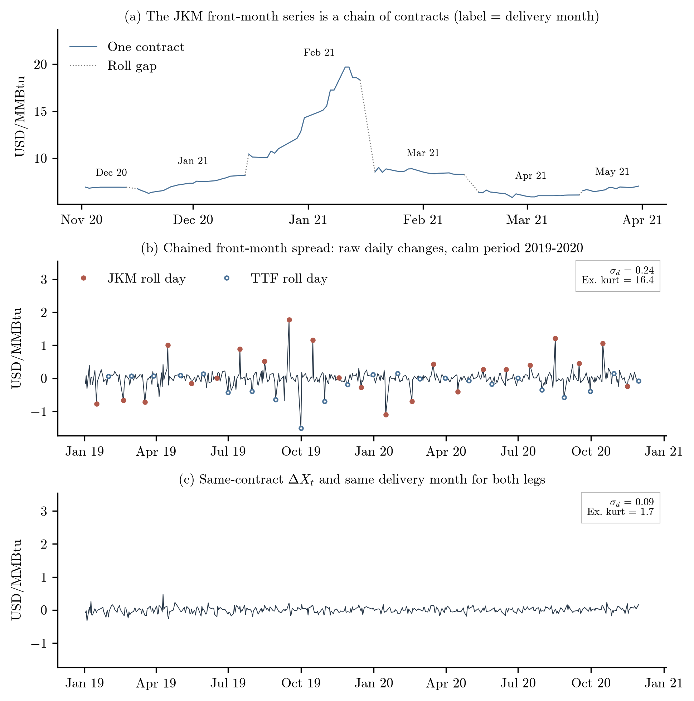
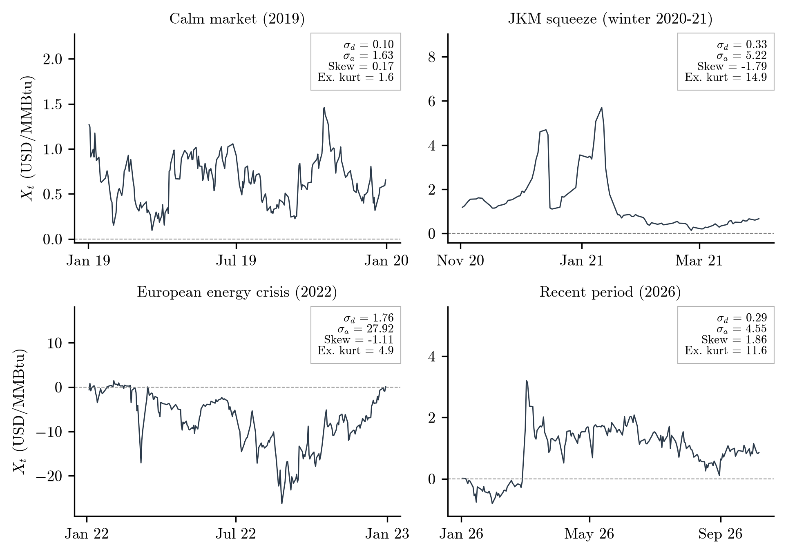
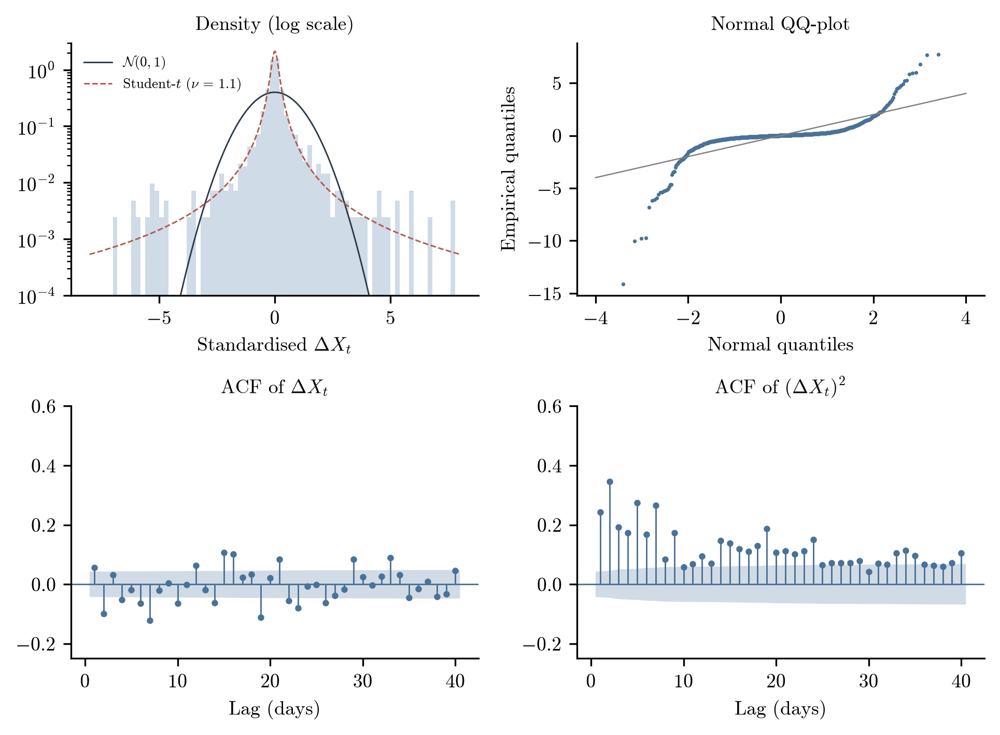
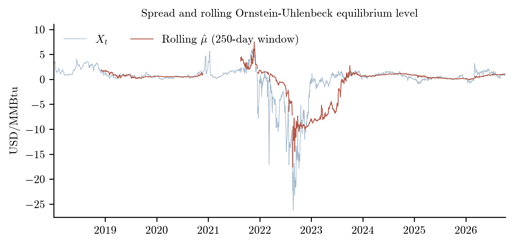
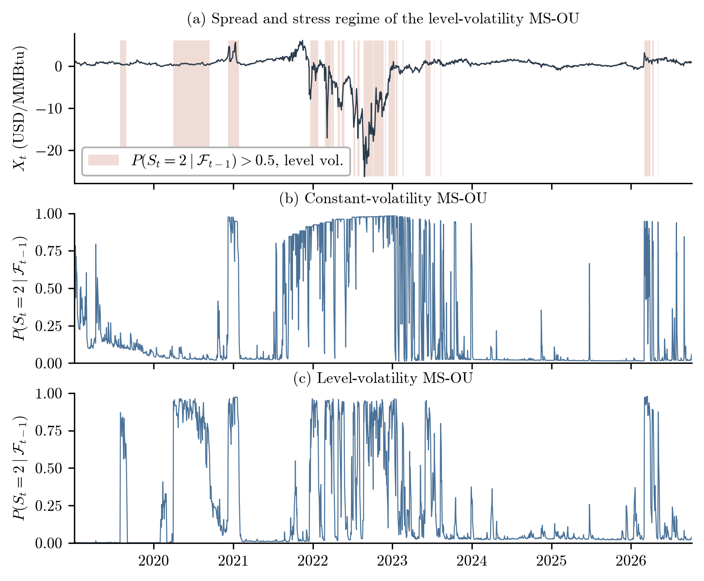
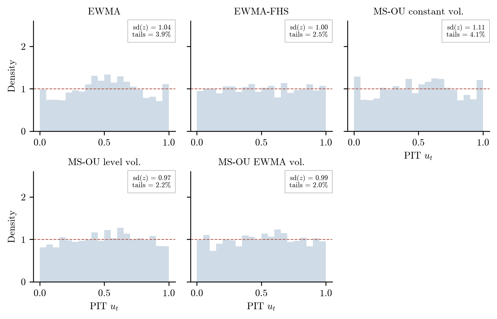
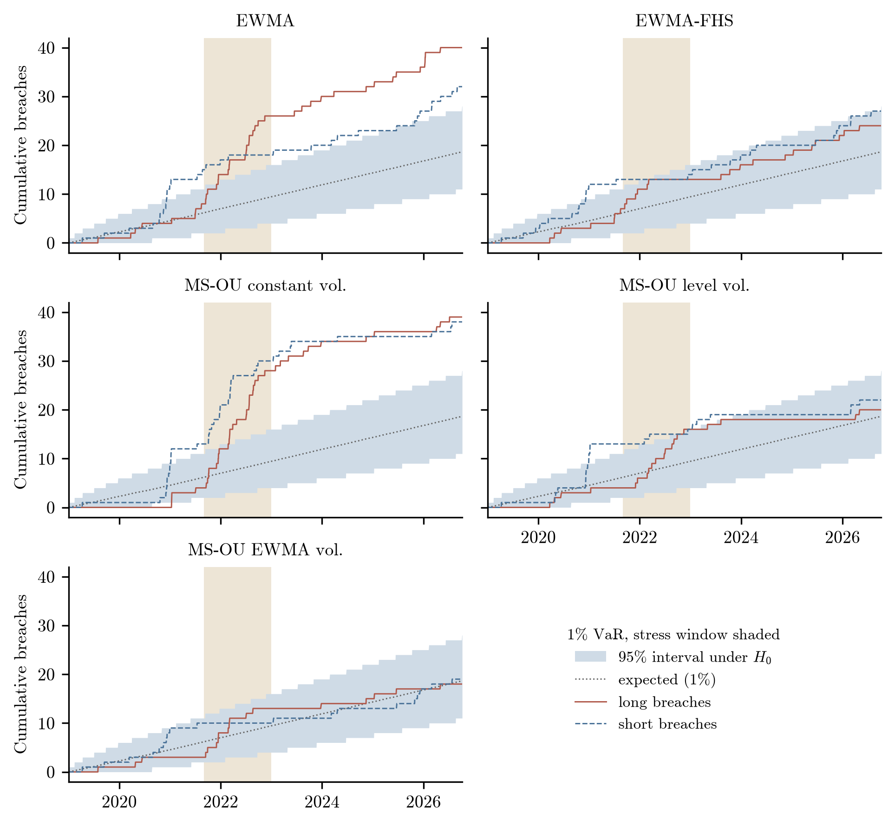
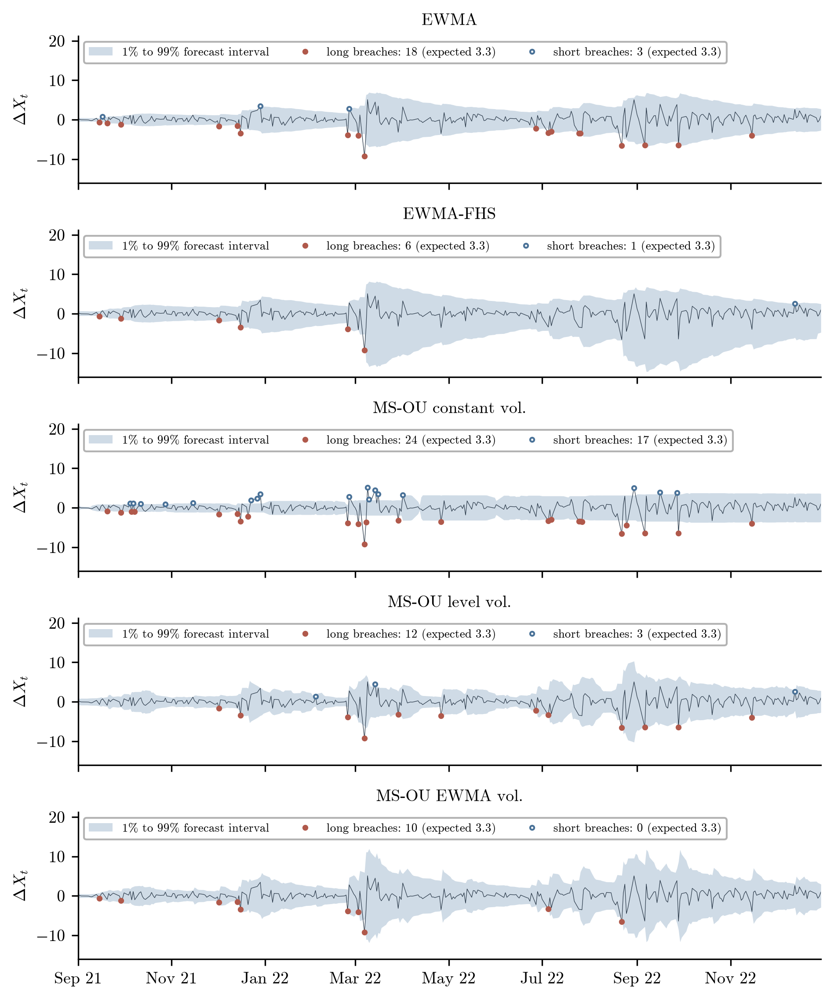
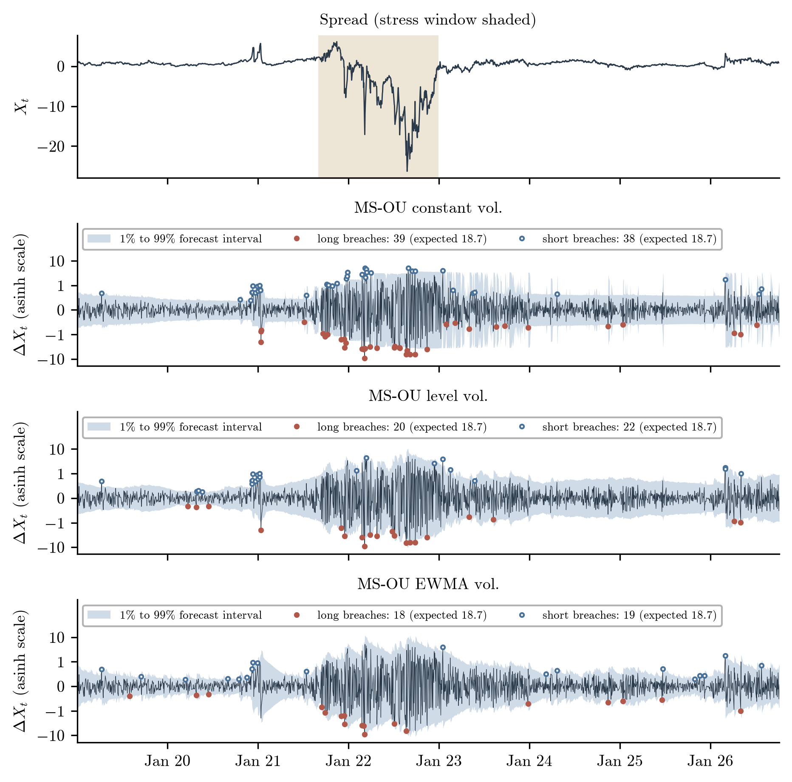
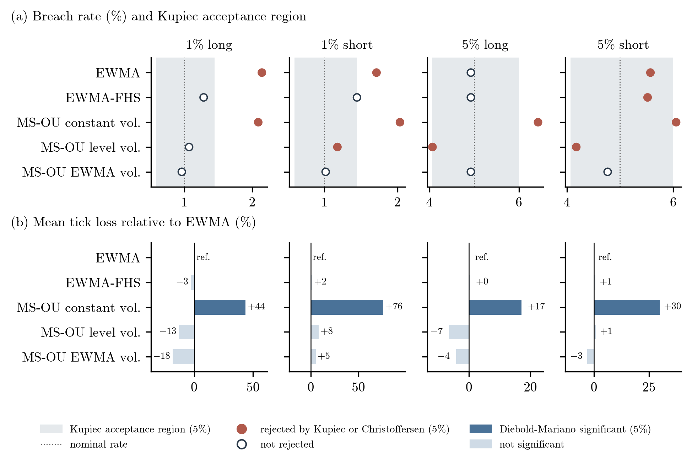

# Methodology

This document explains how the code works, and the results it gives.

| Phase | Content | Script |
|---|---|---|
| 0 | Download of daily settlement prices for TTF and JKM futures (Databento) | `00_download_databento.py` |
| 1 | Spread construction and descriptive statistics | `01_data_analysis.py` |
| 2 | State-dependent mean reversion validation (ADF, KPSS, variance ratios, OU) | `02_stationarity.py` |
| 3 | Value-at-Risk forecasting: EWMA, EWMA-FHS and MS-OU | `03_var_models.py` |
| 4 | Out-of-sample backtesting: Kupiec, Christoffersen, tick loss, Diebold–Mariano | `04_backtest.py` |

---

## Phase 1: Spread Construction (`01_data_analysis.py`)

### 1.1 Data

We work with daily settlement prices (the official closing price published each trading day) for European natural gas futures (TTF, in EUR/MWh) and Asian liquefied natural gas futures (JKM, in USD/MMBtu), downloaded from Databento. To build a spread, TTF first has to be put in the same currency and energy unit, using the ECB EUR/USD daily rate:

```math
S^{TTF}_t\,[\text{USD/MMBtu}] = \frac{S^{TTF}_t\,[\text{EUR/MWh}] \times \text{EURUSD}_t}{3.412142}
```

Once matched, 2,082 trading days line up between January 2, 2018 and October 7, 2026. One problem needs fixing. On UK or Singapore holidays, JKM repeats the previous settlement while European gas keeps trading. We drop those days, since keeping them would create artificial price gaps.

### 1.2 Constant-Delivery-Month Construction

A continuously rolling front-month contract is easy to build, but it carries three biases:

1. Roll-date discontinuities: moving from November to December, for example, creates a step change that comes from seasonality, not from the market.
2. Delivery misalignment: JKM rolls around mid-month, TTF at month-end. Comparing their front months means comparing different delivery windows for almost half of every month.
3. Volatility fade into expiry: JKM settles against an average of prices over time. As expiry nears, less weight remains in the average, so daily volatility looks artificially small, falling from over 3% to under 1%.

To avoid this, we build the spread on the same delivery month $`M_t`$ on both legs. On the JKM side we take the second maturity rank, the nearest contract that has not yet entered its final averaging window. The spread and its daily change are:

```math
X_t = S^{JKM}_t(M_t) - S^{TTF}_t(M_t), \qquad \Delta X_t = \left[S^{JKM}_t(M_{t-1}) - S^{TTF}_t(M_{t-1})\right] - X_{t-1}
```

When the reference month moves to the next contract (105 times in our sample), we roll the spread forward. Both contracts trade actively that day, so $`\Delta X_t`$ measures the return on the position actually held overnight. No artificial jump enters the series.

<p align="center"></p>

- In the chained front-month spread (b), the ten largest daily moves of the calm period are all roll artifacts.
- With the constant-delivery-month construction (c), those jumps go away, and daily standard deviation falls from 0.24 to 0.09 USD/MMBtu.

### 1.3 Summary Statistics by Period

For each series we compute the sample mean, the daily standard deviation $`\hat\sigma`$, skewness and excess kurtosis:

| Series | N | Mean | $`\hat\sigma`$ | Skewness | Excess Kurtosis | Min | Max |
|---|---:|---:|---:|---:|---:|---:|---:|
| $`X_t`$ | 2082 | −0.077 | 3.604 | −3.42 | 13.6 | −26.30 | 6.14 |
| $`\Delta X^{f}_t`$ (chained front-month) | 2081 | −0.002 | 1.325 | 0.89 | 36.1 | −14.42 | 15.04 |
| $`\Delta X_t`$ (constant delivery month) | 2081 | 0.001 | 0.659 | −2.53 | 46.1 | −9.29 | 5.09 |

- Trading the constant delivery month instead of the chained front month halves the daily standard deviation, from 1.325 to 0.659 USD/MMBtu.
- The tails are extreme. Excess kurtosis of 46.1 means extreme moves happen much more often than under a normal distribution.

Daily volatility $`\sigma_d`$ and annualised volatility $`\sigma_a = \sigma_d\sqrt{252}`$ shift a lot with the macro and geopolitical backdrop:

| $`\Delta X_t`$ by Period | $`\sigma_d`$ | $`\sigma_a`$ | Skewness | Excess Kurtosis |
|---|---:|---:|---:|---:|
| Calm market (2019) | 0.10 | 1.63 | 0.17 | 1.6 |
| JKM squeeze (2020-11 → 2021-03) | 0.33 | 5.22 | −1.79 | 14.9 |
| European energy crisis (2022) | 1.76 | 27.92 | −1.11 | 4.9 |
| Recent period (2026) | 0.29 | 4.55 | 1.86 | 11.6 |

<p align="center"></p>

### 1.4 Distribution and Temporal Dependence

We standardise the spread changes, $`z_t = (\Delta X_t - \bar\mu)/\hat\sigma`$, and compare them with a standard normal and with a Student-$`t`$ fitted by maximum likelihood.

<p align="center"></p>

- The tails are heavy (Student-$`t`$ with $`\hat\nu = 1.12`$). Large moves happen far more often than a normal distribution predicts. Part of this comes from calm periods and volatility shocks sitting in the same sample.
- Daily changes carry no memory ($`\hat\rho(1) = +0.056`$): no persistent momentum, and no fast mean reversion either. The negative autocorrelation of the raw front-month series (−0.17) was a holiday effect only.
- Volatility clusters strongly. Tomorrow's direction is essentially unpredictable, yet squared daily changes stay correlated over the first 9 trading days. Volatile sessions follow volatile sessions, calm sessions follow calm ones.

The constant-delivery spread removes roll bias and holiday distortions, and halves apparent volatility. The fat tails left over come from shifts in volatility regimes.

---

## Phase 2: Mean Reversion Validation (`02_stationarity.py`)

To check whether the spread pulls back to an equilibrium, we run the Augmented Dickey-Fuller (ADF) and KPSS tests together. They test opposite null hypotheses, so the pair settles the question better than either alone.

The ADF test looks for a unit root (a random walk) with the regression:

```math
\Delta X_t = c + \beta X_{t-1} + \sum_{i=1}^{p} \gamma_i \Delta X_{t-i} + \varepsilon_t
```

Here $`\Delta X_t = X_t - X_{t-1}`$ is the daily change, $`c`$ is a drift constant, and $`\beta`$ measures mean reversion (for $`\beta < 0`$, moves are pulled back when $`X_{t-1}`$ is far from zero). The $`p`$ lagged differences, with coefficients $`\gamma_i`$, strip serial correlation from the residuals $`\varepsilon_t`$.

The parameters $`\theta = [c, \beta, \gamma_1, \dots, \gamma_p]^\top`$ are estimated by ordinary least squares (OLS), so $`\hat\theta = (Z^\top Z)^{-1} Z^\top Y`$, where $`Y`$ holds $`\Delta X_t`$ and $`Z`$ the regressors. The reversion speed is the second element of $`\hat\theta`$, with standard error $`\text{se}(\hat\beta) = s \sqrt{[(Z^\top Z)^{-1}]_{2,2}}`$ and residual variance $`s^2 = \frac{1}{T-2p-2}\sum \hat\varepsilon_t^2`$.

Under the unit root null ($`H_0 : \beta = 0`$, against $`H_1 : \beta < 0`$), the statistic $`\tau = \hat\beta / \text{se}(\hat\beta)`$ does not follow a standard distribution. It is compared with MacKinnon critical values ($`\approx -2.86`$ at the 5% level), and the lag order $`p`$ minimises the Bayesian Information Criterion:

```math
\text{BIC}(p) = (T-p) \ln\left(\frac{1}{T-p}\sum_{t=p+1}^{T} \hat\varepsilon_t^2\right) + (p + 2)\ln(T-p)
```

The strict $`\ln(T-p)`$ penalty keeps the test from fitting transient volatility spikes.

The KPSS test goes the other way: it assumes stationarity ($`H_0 : X_t \sim \text{I}(0)`$) and looks for drift through cumulative deviations from the sample mean $`\overline{X}`$:

```math
\eta = \frac{1}{T^2\, \hat\sigma^2_{\text{HAC}}} \sum_{t=1}^{T} S_t^2
```

where $`T`$ is the number of sessions, $`S_t = \sum_{s=1}^{t} (X_s - \overline{X})`$ accumulates pricing errors (they cancel out when the series is stationary, and pile up when it drifts), and $`\hat\sigma^2_{\text{HAC}}`$ is the Newey-West long-run variance, which corrects for heteroskedasticity and autocorrelation.

Reading both tests at 5% separates real stationarity (ADF rejects, KPSS does not) from a random walk (ADF does not reject, KPSS rejects).

#### Results

| Sample | N | Lags ($`p`$) | ADF $`\tau`$ | ADF p-value | KPSS $`\eta`$ | KPSS p-value | Joint Conclusion |
|---|---:|---:|---:|---:|---:|---:|---|
| Full sample (2018–2026) | 2082 | 7 | −1.58 | 0.493 | 0.54 | 0.033 | Unit root |
| Pre-crisis | 616 | 1 | −2.36 | 0.154 | 1.20 | 0.010 | Unit root |
| Crisis | 328 | 0 | −1.68 | 0.441 | 1.87 | 0.010 | Unit root |
| Post-crisis | 923 | 0 | −4.09 | 0.001 | 0.43 | 0.066 | Stationary |

- Post-crisis, both tests agree on stationarity. ADF clearly rejects a random walk ($`\tau = -4.09 < -2.86`$) and KPSS cannot reject stationarity ($`\eta = 0.43 < 0.463`$). After the crisis, the spread showed a strong and significant pull toward equilibrium.
- Pre-crisis and crisis both behave like unit roots. ADF finds no significant pull ($`\tau = -2.36`$ and $`-1.68`$) and KPSS rejects stationarity ($`\eta = 1.20`$ and $`1.87`$). Before the crisis the spread was trending, and the 2022 shock broke the link between the two prices.
- On the full sample, structural breaks hide local stationarity. The 2018–2026 series tests as non-stationary, but this is a test artifact: the equilibrium level jumps between regimes rather than the series wandering freely (Perron, 1989). A stationary series whose equilibrium level moves over time will fool any single-regime test. That is the case for a regime-switching framework.
- Cleaning the data removes false signals. ADF on the raw, unadjusted front-month rolls shows fast mean reversion on the full sample ($`p = 0.012`$, a 14-day half-life). Aligning delivery months weakens the effect ($`p = 0.267`$), and filtering holiday rollovers removes it altogether ($`p = 0.493`$). The apparent reversion came only from roll gaps and holiday bounces that reversed the next day.

### 2.2 Variance Ratios

The variance ratio (Lo & MacKinlay) compares the variance of $`q`$-day changes with $`q`$ times the daily variance. It equals 1 for a random walk, drops below 1 under mean reversion (negative autocorrelation), and rises above 1 when prices trend:

```math
VR(q) = \frac{\mathrm{Var}(\Delta X_t + \dots + \Delta X_{t-q+1})}{q \cdot \mathrm{Var}(\Delta X_t)} \approx 1 + 2\sum_{j=1}^{q-1}\left(1 - \frac{j}{q}\right)\hat{\rho}(j)
```

The test statistic $`z^*`$ is robust to heteroskedasticity, which matters here because volatility changes so much across regimes.

| Sample | $`VR(5)`$ | p-value | $`VR(20)`$ | p-value |
|---|---:|---:|---:|---:|
| Full sample (2018–2026) | 0.98 | 0.898 | 0.64 | 0.319 |
| Pre-crisis | 1.56 | 0.071 | 1.79 | 0.150 |
| Crisis | 0.98 | 0.921 | 0.57 | 0.274 |
| Post-crisis | 0.82 | 0.145 | 0.43 | 0.049 |

- Post-crisis, the 20-day ratio is only 0.43 ($`p = 0.049`$): more than half of any displacement is reabsorbed within a month.
- Pre-crisis, $`VR(q) > 1.5`$, so the spread trends (the 2020 collapse, the early 2021 recovery).
- During the crisis, $`VR(q) < 1`$ but not significantly. The extreme variance inflates the standard errors and drains the test of power.

### 2.3 Ornstein-Uhlenbeck Calibration

The continuous-time Ornstein-Uhlenbeck (OU) process is

```math
dX_t = \theta(\mu - X_t)\,dt + \sigma\,dW_t
```

and pulls the spread toward the equilibrium level $`\mu`$ at speed $`\theta`$.

Applying Itô's lemma to $`f(t,X_t) = e^{\theta t}X_t`$ gives

```math
X_{t+\Delta t} = \mu + (X_t - \mu) e^{-\theta \Delta t} + \sigma \int_t^{t+\Delta t} e^{-\theta (t + \Delta t - s)} \, dW_s
```

For $`\Delta t = 1`$, the same dynamic reads

```math
X_t = c + \phi X_{t-1} + \eta_t, \quad \eta_t \overset{\text{i.i.d.}}{\sim} \mathcal{N}\left(0, \, \frac{\sigma^2}{2\theta} \left(1 - e^{-2\theta}\right)\right)
```

with $`\phi = e^{-\theta}`$ and $`c = \mu (1 - e^{-\theta})`$. That is an AR(1), estimated by OLS:

```math
b = 1 + \hat\beta = e^{-\theta}, \qquad
\hat\mu = -\frac{\hat a}{\hat\beta}, \qquad
t_{1/2} = \frac{\ln 2}{\hat\theta}
```

The half-life $`t_{1/2}`$ is the expected time needed to absorb 50% of a deviation from equilibrium.

| Sample Period | $`b`$ | $`\hat\theta`$ | $`\hat\mu`$ | $`\hat\sigma`$ | Half-life $`t_{1/2}`$ (days) |
|---|---:|---:|---:|---:|---:|
| Full sample (2018–2026) | 0.989 | 0.011 | 0.01 | 0.66 | 60.4 |
| Pre-crisis | 0.998 | 0.002 | — | 0.16 | 295 |
| Crisis | 0.979 | 0.021 | −6.39 | 1.60 | 32.5 |
| Post-crisis | 0.953 | 0.049 | 0.76 | 0.26 | 14.2 |
| Calm market (2019) | 0.903 | 0.102 | 0.60 | 0.11 | 6.8 |
| JKM squeeze | 0.998 | 0.002 | — | 0.33 | 393 |
| European crisis (2022) | 0.963 | 0.037 | −8.82 | 1.79 | 18.6 |
| Recent period (2026) | 0.951 | 0.050 | 1.17 | 0.29 | 13.8 |

- In calm markets, deviations clear within one to two weeks (14 days post-crisis, 7 days in 2019).
- Before the crisis, and during the JKM squeeze, there is no mean reversion at all ($`b \approx 1`$, $`\hat\mu`$ unidentifiable).

### 2.4 Regime Persistence

Rolling equilibrium estimates $`\hat\mu_t`$ are computed on 250-day windows. They are masked whenever the implied half-life exceeds 125 days, beyond which $`\mu`$ cannot be identified:

<p align="center"></p>

- The equilibrium level sits on persistent plateaus: +0.3 to +1.3 in 2019–2020, −9.9 to −5.2 from 2022-09 to 2023-06, and +0.1 to +1.1 since 2024.
- Discrete, persistent plateaus like these are exactly what a two-regime Markov-switching framework is made for.

Mean reversion therefore depends on the state of the market. It is fast when markets are calm (two-week half-life), absent during trends, and hidden during crises. A regime-switching model should only give a regime mean-reverting drift when the data identifies one. That is the core specification rule for Phase 3.

---

## Phase 3: Value-at-Risk Forecasting (`03_var_models.py`)

### Overview

We compare three baseline frameworks, covering five specifications. Each one gives one-step-ahead forecasts of the conditional distribution of spread increments $`\Delta X_t = X_t - X_{t-1}`$, and predictive quantiles $`q_t(p)`$ at $`p \in \{1\%, 5\%, 95\%, 99\%\}`$.

For a tail probability $`\alpha \in \{1\%, 5\%\}`$, directional VaR is defined as:
- Long position ($`\text{VaR}^L_t`$): loses when the spread collapses ($`\Delta X_t < 0`$), so it uses the lower tail, $`\text{VaR}^L_t(\alpha) = -q_t(\alpha)`$.
- Short position ($`\text{VaR}^S_t`$): loses when the spread spikes ($`\Delta X_t > 0`$), so it uses the upper tail, $`\text{VaR}^S_t(\alpha) = q_t(1 - \alpha)`$.

### 3.1 EWMA (RiskMetrics Benchmark)

The RiskMetrics benchmark (J.P. Morgan & Reuters, 1996) assumes no conditional drift, Gaussian innovations, and a variance updated recursively:

```math
\sigma_t^2 = \lambda \sigma_{t-1}^2 + (1 - \lambda) (\Delta X_{t-1})^2, \qquad \lambda = 0.94
```

Under conditional normality the one-step-ahead quantile is $`q_t(p) = \Phi^{-1}(p) \, \sigma_t`$, where $`\Phi^{-1}(\cdot)`$ is the standard normal inverse CDF.

### 3.2 EWMA-FHS (Filtered Historical Simulation)

Filtered Historical Simulation (Barone-Adesi et al., 1999) keeps the EWMA volatility dynamics but drops the Gaussian assumption. It uses the empirical distribution of standardised historical shocks over a rolling 250-day window ($`\tau \in [t - 250, \, t - 1]`$):

```math
\epsilon_\tau = \frac{\Delta X_\tau}{\sigma_\tau} \implies q_t(p) = \sigma_t \cdot \hat{Q}_p\left( \{\epsilon_\tau\}_{\tau = t-250}^{t-1} \right)
```

Here $`\hat{Q}_p(\cdot)`$ is the empirical sample quantile. Over the sample, $`\hat{Q}_{1\%} \approx -2.84`$ and $`\hat{Q}_{99\%} \approx 2.60`$, against $`\mp 2.33`$ under normality. This widens the 99% VaR by about 22% for long positions and 12% for short positions, compared with parametric EWMA.

### 3.3 Markov-Switching Ornstein-Uhlenbeck (MS-OU)

#### 3.3.1 Regime-Switching Dynamics
To catch the shifts between calm and turbulent states, the spread follows a latent regime variable $`S_t \in \{1, 2\}`$, a first-order Markov chain with transition matrix:

```math
P = \begin{pmatrix} p_{11} & 1 - p_{11} \\ 1 - p_{22} & p_{22} \end{pmatrix}, \qquad p_{ij} = \mathbb{P}(S_t = j \mid S_{t-1} = i)
```

Inside a regime $`S_t = s`$, the spread is an Ornstein-Uhlenbeck process $`dX_t = \theta_s (\mu_s - X_t) \, dt + \sigma_s \, dW_t`$. Over one day ($`\Delta t = 1`$) this gives the exact discrete-time form:

```math
\Delta X_t = m_{s,t} + c_{s,t} \, \epsilon_t, \qquad m_{s,t} = (1 - e^{-\theta_s})(\mu_s - X_{t-1}), \qquad \epsilon_t \overset{\text{i.i.d.}}{\sim} \mathcal{D}(0, 1)
```

where $`m_{s,t}`$ is the regime drift (a driftless random walk as $`\theta_s \to 0`$), $`c_{s,t}`$ the regime scale factor, and $`\epsilon_t`$ a standardised zero-mean, unit-variance shock from $`\mathcal{D}(0, 1)`$, either Gaussian $`\mathcal{N}(0, 1)`$ or standardised Student-$`t_\nu`$.

#### 3.3.2 The Three MS-OU Specifications
All three share the mean-reverting drift $`m_{s,t}`$. They differ in the scale $`c_{s,t}`$ and in the shock distribution $`\epsilon_t`$:

| Specification | Scale Factor $`c_{s,t}`$ | Innovation $`\epsilon_t`$ | Economic Motivation |
|---|---|---|---|
| **Constant-Volatility MS-OU** | $`\sigma_{\eta, s} = \sqrt{\dfrac{\sigma_s^2}{2\theta_s} \left(1 - e^{-2\theta_s}\right)}`$ | $`\mathcal{N}(0, 1)`$ | Exact continuous-time OU baseline with regime-specific variance. |
| **Level-Dependent MS-OU** | $`k_s \, L_{t-1}, \quad L_t = \dfrac{S^{\text{TTF}}_t + S^{\text{JKM}}_t}{2}`$ | Student-$`t_\nu`$ | Shocks scale with absolute commodity price levels ($`L_{t-1}`$); heavy tails catch extreme spikes. |
| **EWMA-Volatility MS-OU** | $`k_s \, \hat{\sigma}_t^{\text{EWMA}}`$ | $`\mathcal{N}(0, 1)`$ | Adds adaptive high-frequency volatility clustering on top of structural mean-reverting states. |

#### 3.3.3 Estimation via the Hamilton Filter
The regimes $`S_t`$ are latent, so the parameters $`\Theta`$ are estimated by maximum likelihood with the recursive filter of Hamilton (1989, 1994). Let $`\mathcal{F}_{t-1}`$ be the information set at $`t-1`$, $`\xi_{t|t} = \big[\mathbb{P}(S_t = 1 \mid \mathcal{F}_t), \, \mathbb{P}(S_t = 2 \mid \mathcal{F}_t)\big]^\top`$ the filtered regime probabilities, and $`f_t = \big[f(\Delta X_t \mid S_t = 1, \mathcal{F}_{t-1}), \, f(\Delta X_t \mid S_t = 2, \mathcal{F}_{t-1})\big]^\top`$ the regime-conditional densities:

```math
f(\Delta X_t \mid S_t = s, \mathcal{F}_{t-1}) = \frac{1}{c_{s,t}} f_0\left( \frac{\Delta X_t - m_{s,t}}{c_{s,t}} \right)
```

where $`f_0(\cdot)`$ is the standard density ($`\mathcal{N}(0, 1)`$ or Student-$`t_\nu`$). Filtering alternates prediction and Bayesian updating, with $`\odot`$ the Hadamard product:

```math
\xi_{t|t-1} = P^\top \xi_{t-1|t-1}, \qquad \xi_{t|t} = \frac{\xi_{t|t-1} \odot f_t}{\xi_{t|t-1}^\top f_t}
```

The log-likelihood over $`T`$ observations follows directly from the one-step-ahead marginal densities:

```math
\ln \mathcal{L}(\Theta) = \sum_{t=1}^{T} \ln\left( \xi_{t|t-1}^\top f_t \right)
```

### 3.4 MS-OU: Drift Selection and Walk-Forward Estimation

Parameters are estimated with L-BFGS-B under the restriction $`c_2 = r \cdot c_1`$ ($`r \ge 1`$), which names Regime 1 as the low-volatility state. Following Phase 2, drift is kept only where it is significant. We test for no drift in Regime 2 first, then in the remaining regime, with Likelihood Ratio tests:

```math
LR = 2\left(\ln \mathcal{L}_1 - \ln \mathcal{L}_0\right) \sim \chi^2(2) \quad \text{under } H_0 : \theta_s = 0
```

| Model | $`H_0`$: No Drift in Regime 2 ($`p`$-val) | $`H_0`$: No Drift in Remaining Regime ($`p`$-val) | Retained Specification |
|---|---:|---:|---|
| Constant-volatility MS-OU | 0.368 | 0.007 | Regime 1 drift only |
| Level-dependent MS-OU | < 0.001 | 0.312 | Regime 2 drift only |
| EWMA-volatility MS-OU | 0.181 | 0.034 | Regime 1 drift only |

Constant-volatility and EWMA-volatility MS-OU keep drift in the calm regime and follow a random walk in the volatile one, as Phase 2 predicted.
Level-dependent MS-OU keeps drift in Regime 2, because its regimes track volatility relative to price level rather than macro stress.
Without this rule, insignificant drifts get pushed to the optimisation bounds ($`\hat\theta = 0.001`$, $`\hat\mu = 6.14`$) and bias the forecasts.

Parameters are recalibrated every month on expanding windows (94 recalibrations per model). Full-sample estimates and fit metrics:

| Model | Regime | $`\hat\theta`$ | $`\hat\mu`$ | Scale | Half-life $`t_{1/2}`$ (d) | $`\hat p_{ss}`$ | Duration (d) |
|---|---|---:|---:|---:|---:|---:|---:|
| Constant-volatility MS-OU | 1 | 0.013 | 0.82 | $`\sigma = 0.14`$ | 51.5 | 0.984 | 64 |
| | 2 | 0 | — | $`\sigma = 1.46`$ | — | 0.935 | 15 |
| Level-dependent MS-OU ($`\hat\nu = 4.14`$) | 1 | 0 | — | $`k = 0.009`$ | — | 0.989 | 89 |
| | 2 | 0.024 | 0.69 | $`k = 0.022`$ | 29.0 | 0.986 | 73 |
| EWMA-volatility MS-OU | 1 | 0.009 | 0.91 | $`k = 0.75`$ | 73.9 | 0.946 | 19 |
| | 2 | 0 | — | $`k = 1.98`$ | — | 0.800 | 5 |

| Model | Log-Likelihood ($`\ln \mathcal{L}`$) | Parameters ($`k`$) | BIC |
|---|---:|---:|---:|
| Standalone OU (single regime) | −2079.6 | 3 | 4182.2 |
| EWMA | 117.2 | 0 | −234.4 |
| Constant-volatility MS-OU | 76.1 | 6 | −106.3 |
| Level-dependent MS-OU | 366.0 | 7 | −678.4 |
| EWMA-volatility MS-OU | 354.0 | 6 | −662.1 |

Switching regimes improves the fit hugely over a single-regime OU, and the level and EWMA MS-OU models beat EWMA by a wide margin.
Regime 2 of the EWMA-volatility MS-OU catches short bursts (expected duration 5 days) where volatility runs at 2.6 times the baseline.
The estimated half-lives are long (29 to 74 days), so at a 1-day horizon the drift has only a small predictive pull.

### 3.5 Out-of-Sample Regime Paths

<p align="center"></p>

Constant-volatility MS-OU detects the stress regime in autumn 2021 and stays there for 95% of 2022.
Level-dependent MS-OU Regime 2 covers 66% of 2022 and 49% of 2020, when low price levels inflated relative volatility.
EWMA-volatility MS-OU Regime 2 fires on 4% to 18% of days per year, catching short spikes whether or not there is a macro crisis.

### 3.6 Density Calibration (Probability Integral Transform)

The PIT (Diebold, Gunther & Tay, 1998) maps realised changes into the one-step-ahead forecast CDF: $`u_t = F_t(\Delta X_t)`$ and $`z_t = \Phi^{-1}(u_t)`$. If the density is right, $`u_t \sim \mathcal{U}[0, 1]`$ and $`z_t \sim \mathcal{N}(0, 1)`$. A standard deviation of $`z_t`$ above 1 means the density is too narrow, and exactly 2% of observations should fall outside $`[1\%, 99\%]`$.

| Model | Std Dev of $`z_t`$ | 2019–2020 | 2021–2022 | 2023–2026 | Tail Share $`\notin [1\%, 99\%]`$ |
|---|---:|---:|---:|---:|---:|
| EWMA | 1.04 | 1.07 | 1.10 | 1.00 | 3.9% |
| EWMA-FHS | 1.00 | 1.04 | 0.96 | 1.00 | 2.5% |
| Constant-volatility MS-OU | 1.11 | 0.93 | 1.43 | 0.98 | 4.1% |
| Level-dependent MS-OU | 0.97 | 1.13 | 1.03 | 0.84 | 2.2% |
| EWMA-volatility MS-OU | 0.99 | 1.04 | 0.95 | 0.98 | 2.0% |

<p align="center"></p>

EWMA-FHS and EWMA-volatility MS-OU are almost perfectly calibrated. Standard EWMA clearly underestimates the tails (3.9% outside the interval).
Constant-volatility MS-OU is too narrow in the crisis ($`s(z) = 1.43`$).
Level-dependent MS-OU is too narrow in 2019–2020 and too wide after 2023: its calibration slides over time.

### 3.7 Average Predicted VaR Levels

| Average Quantile | 2019: $`q(1\%)`$ | 2019: $`q(99\%)`$ | 2022: $`q(1\%)`$ | 2022: $`q(99\%)`$ |
|---|---:|---:|---:|---:|
| EWMA | −0.25 | 0.25 | −3.87 | 3.87 |
| EWMA-FHS | −0.28 | 0.33 | −7.64 | 4.18 |
| Constant-volatility MS-OU | −0.36 | 0.36 | −2.93 | 2.93 |
| Level-dependent MS-OU | −0.28 | 0.29 | −3.63 | 3.67 |
| EWMA-volatility MS-OU | −0.31 | 0.31 | −4.86 | 4.87 |

In calm 2019, all models forecast similar risk levels.
In crisis 2022, EWMA-FHS sharpens its left tail a lot (−7.64), constant MS-OU stays too narrow (−2.93), and EWMA-volatility MS-OU gives bands 25% wider than standard EWMA.

EWMA-FHS fixes the thin-tail bias of the Gaussian. Constant MS-OU is badly misspecified, and level-dependent MS-OU is non-stationary. EWMA-volatility MS-OU is well calibrated, mostly thanks to the volatility regime switches. Phase 4 puts all five through an out-of-sample backtest.

---

## Phase 4: VaR Backtesting (`04_backtest.py`)

VaR forecasts are tested against realised changes over 1,867 days, for long and short positions at 1% and 5%, on the whole sample and split into a stress period (2021-09 → 2022-12, 328 days) and a non-stress period (1,539 days).

### 4.1 Coverage Testing

A VaR breach happens when the realised loss is larger than the forecast VaR:

```math
I^{L}_t = \mathbb{1}\left\{\Delta X_t < q_t(\alpha)\right\}, \qquad I^{S}_t = \mathbb{1}\left\{\Delta X_t > q_t(1 - \alpha)\right\}
```

- Kupiec (1995) Unconditional Coverage: a likelihood ratio test of $`H_0 : P(I_t = 1) = \alpha`$, with observed breach frequency $`\hat\pi = x/n`$:

```math
LR_{uc} = -2 \ln \frac{(1 - \alpha)^{n - x}\, \alpha^{x}}{(1 - \hat\pi)^{n - x}\, \hat\pi^{x}} \sim \chi^2(1)
```

- Christoffersen (1998) Conditional Coverage: tests whether breaches are independent (hits modelled as a first-order Markov chain, $`H_0 : \pi_{01} = \pi_{11}`$, $`LR_{ind} \sim \chi^2(1)`$) and joint conditional coverage ($`LR_{cc} = LR_{uc} + LR_{ind} \sim \chi^2(2)`$).

Over the full sample, 18.7 breaches are expected at 1% and 93.4 at 5% ($`uc`$: unconditional; $`ind`$: independence; $`cc`$: conditional coverage):

| Case | Model | Breaches | Breach Rate | Kupiec p-val | Independence p-val | Cond. Cov. p-val | Rejected $`H_0`$ at 5% |
|---|---|---:|---:|---:|---:|---:|---|
| Long 1% | EWMA | 40 | 2.14% | < 0.001 | 0.279 | < 0.001 | $`uc, cc`$ |
| | EWMA-FHS | 24 | 1.29% | 0.235 | 0.429 | 0.361 | None |
| | Constant MS-OU | 39 | 2.09% | < 0.001 | 0.001 | < 0.001 | $`uc, ind, cc`$ |
| | Level MS-OU | 20 | 1.07% | 0.760 | 0.510 | 0.768 | None |
| | EWMA MS-OU | 18 | 0.96% | 0.875 | 0.554 | 0.829 | None |
| Short 1% | EWMA | 32 | 1.71% | 0.005 | 0.577 | 0.016 | $`uc, cc`$ |
| | EWMA-FHS | 27 | 1.45% | 0.069 | 0.406 | 0.136 | None |
| | Constant MS-OU | 38 | 2.04% | < 0.001 | < 0.001 | < 0.001 | $`uc, ind, cc`$ |
| | Level MS-OU | 22 | 1.18% | 0.451 | < 0.001 | < 0.001 | $`ind, cc`$ |
| | EWMA MS-OU | 19 | 1.02% | 0.939 | 0.532 | 0.820 | None |
| Long 5% | EWMA | 92 | 4.93% | 0.886 | 0.489 | 0.779 | None |
| | EWMA-FHS | 92 | 4.93% | 0.886 | 0.787 | 0.954 | None |
| | Constant MS-OU | 120 | 6.43% | 0.007 | 0.012 | 0.001 | $`uc, ind, cc`$ |
| | Level MS-OU | 76 | 4.07% | 0.057 | 0.004 | 0.002 | $`ind, cc`$ |
| | EWMA MS-OU | 92 | 4.93% | 0.886 | 0.163 | 0.374 | None |
| Short 5% | EWMA | 104 | 5.57% | 0.266 | 0.002 | 0.004 | $`ind, cc`$ |
| | EWMA-FHS | 103 | 5.52% | 0.313 | 0.034 | 0.063 | $`ind`$ |
| | Constant MS-OU | 113 | 6.05% | 0.043 | < 0.001 | < 0.001 | $`uc, ind, cc`$ |
| | Level MS-OU | 78 | 4.18% | 0.094 | < 0.001 | < 0.001 | $`ind, cc`$ |
| | EWMA MS-OU | 89 | 4.77% | 0.642 | 0.397 | 0.627 | None |

- EWMA-volatility MS-OU is the only model never rejected. Its breach rates sit very close to nominal (0.96% and 1.02% at 1%).
- EWMA underestimates both tails at 1% (2.14% and 1.71%). EWMA-FHS is rejected only once, on 5% independence.
- Level-dependent MS-OU gets the counts right but clusters its breaches badly. Constant MS-OU fails on every front.

<p align="center"></p>

- Cumulative breaches of EWMA-volatility MS-OU stay inside the 95% binomial envelope over the whole 8-year span.
- EWMA drifts outside the envelope in both directions, and keeps drifting after the crisis.

### 4.2 Coverage Across Market Regimes

In stress, 3.3 breaches are expected at 1% and 16.4 at 5%. Outside stress, 15.4 and 77.0:

| Sample | Model | Long 1% | Short 1% | Long 5% | Short 5% |
|---|---|---|---|---|---|
| Stress | EWMA | 18 ($`uc, cc`$) | 3 (None) | 26 ($`uc`$) | 15 (None) |
| | EWMA-FHS | 6 (None) | 1 (None) | 18 (None) | 12 (None) |
| | Constant MS-OU | 24 ($`uc, cc`$) | 17 ($`uc, cc`$) | 40 ($`uc, cc`$) | 33 ($`uc, ind, cc`$) |
| | Level MS-OU | 12 ($`uc, cc`$) | 3 (None) | 24 ($`cc`$) | 15 (None) |
| | EWMA MS-OU | 10 ($`uc, cc`$) | 0 ($`uc, cc`$) | 22 (None) | 12 (None) |
| Non-stress | EWMA | 22 (None) | 29 ($`uc, cc`$) | 66 (None) | 89 ($`ind, cc`$) |
| | EWMA-FHS | 18 (None) | 26 ($`uc, cc`$) | 74 (None) | 91 ($`cc`$) |
| | Constant MS-OU | 15 ($`ind, cc`$) | 21 ($`ind, cc`$) | 80 (None) | 80 ($`ind, cc`$) |
| | Level MS-OU | 8 ($`uc`$) | 19 ($`ind, cc`$) | 52 ($`uc, ind, cc`$) | 63 ($`ind, cc`$) |
| | EWMA MS-OU | 8 ($`uc`$) | 19 (None) | 70 (None) | 77 (None) |

<p align="center"></p>

- In the crisis, EWMA suffers 18 long 1% breaches against 3.3 expected. Its band widens only after each shock. EWMA-FHS is the only model not rejected during the crisis.
- EWMA-volatility MS-OU is too narrow on the long side (10) and too conservative on the short side (0) in the crisis. Outside it, the model is rejected only on long 1%, and only because it is too conservative (8 breaches against 15.4 expected).

<p align="center"></p>

### 4.3 Quantile Tick Loss

Coverage tests count every breach the same way. Asymmetric quantile tick loss (Giacomini & Komunjer, 2005) also penalises how large a breach is and how wide an uninformative buffer is. It is minimised at the true quantile:

```math
L_t(p) = \left(p - \mathbb{1}\left\{\Delta X_t < q_t(p)\right\}\right)\left(\Delta X_t - q_t(p)\right)
```

| Average Tick Loss | Long 1% | Short 1% | Long 5% | Short 5% |
|---|---:|---:|---:|---:|
| EWMA | 0.0210 | 0.0131 | 0.0556 | 0.0426 |
| EWMA-FHS | 0.0204 | 0.0133 | 0.0558 | 0.0428 |
| Constant-volatility MS-OU | 0.0301 | 0.0230 | 0.0651 | 0.0553 |
| Level-dependent MS-OU | 0.0183 | 0.0141 | 0.0520 | 0.0429 |
| EWMA-volatility MS-OU | 0.0172 | 0.0137 | 0.0533 | 0.0412 |

- EWMA-volatility MS-OU has the lowest loss at long 1% (−18% against EWMA) and short 5% (−3%). At short 1% it is 5% higher.
- The crisis window is 18% of the days but 43% to 76% of total cumulative tick loss.

### 4.4 Diebold–Mariano Hypothesis Testing

To check whether the tick loss differences are significant, the Diebold & Mariano (1995) test runs on the loss differential $`d_t = L^A_t - L^B_t`$, with Newey–West HAC variance and a Bartlett kernel ($`K = \lfloor 4(n/100)^{2/9} \rfloor`$). $`DM < 0`$ means model $`A`$ beats $`B`$:

```math
d_t = L^A_t - L^B_t, \qquad DM = \frac{\overline{d}}{\sqrt{\hat\sigma^2_{LR} / n}} \sim \mathcal{N}(0, 1)
```

| Comparison (A / B) | Long 1% | Short 1% | Long 5% | Short 5% | Decision at 5% Level |
|---|---:|---:|---:|---:|---|
| EWMA-FHS / EWMA | −0.25 (0.799) | 0.44 (0.661) | 0.06 (0.950) | 0.46 (0.643) | Fail to reject across all 4 |
| Constant MS-OU / EWMA | 2.90 (0.004) | 2.50 (0.012) | 3.35 (< 0.001) | 2.83 (0.005) | Reject across all 4; EWMA significantly lower loss |
| Level MS-OU / EWMA | −1.12 (0.261) | 1.53 (0.127) | −1.65 (0.099) | 0.17 (0.862) | Fail to reject across all 4 |
| EWMA MS-OU / EWMA | −1.95 (0.052) | 1.18 (0.240) | −1.86 (0.063) | −1.20 (0.232) | Fail to reject across all 4 (borderline significant) |
| Level MS-OU / EWMA-FHS | −1.11 (0.266) | 1.27 (0.204) | −1.34 (0.181) | 0.04 (0.970) | Fail to reject across all 4 |
| EWMA MS-OU / EWMA-FHS | −2.60 (0.009) | 1.05 (0.293) | −1.19 (0.233) | −1.55 (0.121) | Reject at Long 1%; EWMA MS-OU significantly outperforms |
| EWMA MS-OU / Level MS-OU | −0.80 (0.426) | −0.49 (0.621) | 0.73 (0.463) | −0.97 (0.331) | Fail to reject across all 4 |

- EWMA-volatility MS-OU beats EWMA-FHS significantly at long 1% ($`p = 0.009`$, and it also stands up to the Bonferroni correction at 1.25%). Against standard EWMA the gain is borderline ($`p = 0.052`$ at 1%, $`p = 0.063`$ at 5%).
- Constant MS-OU is significantly worse than EWMA in all four cases.

### 4.5 Synthesis

<p align="center"></p>

In (a), hollow circles mark the models that pass every coverage test. In (b), dark bars mark loss reductions versus EWMA that are significant.

**Conclusion.** The EWMA-volatility MS-OU hybrid is the only model no coverage test rejects, and it has the lowest quantile loss in 2 of 4 cases (−18% on long 1%). Structural models used alone lose to industry benchmarks. Putting regime switching together with an adaptive EWMA filter gives the best risk model of the five.

---

## References

Books:
- Christoffersen, P. (2012). *Elements of Financial Risk Management*, 2nd ed. Academic Press.
- Hamilton, J. D. (1994). [*Time Series Analysis*](https://press.princeton.edu/books/hardcover/9780691042893/time-series-analysis). Princeton University Press.

Articles:
- Barone-Adesi, G., Giannopoulos, K., & Vosper, L. (1999). [VaR without correlations for portfolios of derivative securities](https://ideas.repec.org/a/wly/jfutmk/v19y1999i5p583-602.html). *Journal of Futures Markets*, 19(5), 583–602.
- Christoffersen, P. (1998). [Evaluating interval forecasts](https://ideas.repec.org/a/ier/iecrev/v39y1998i4p841-62.html). *International Economic Review*, 39(4), 841–862.
- Dickey, D. A., & Fuller, W. A. (1979). [Distribution of the estimators for autoregressive time series with a unit root](https://doi.org/10.1080/01621459.1979.10482531). *Journal of the American Statistical Association*, 74(366), 427–431.
- Diebold, F. X., Gunther, T. A., & Tay, A. S. (1998). [Evaluating density forecasts with applications to financial risk management](https://ideas.repec.org/a/ier/iecrev/v39y1998i4p863-83.html). *International Economic Review*, 39(4), 863–883.
- Diebold, F. X., & Mariano, R. S. (1995). [Comparing predictive accuracy](https://ideas.repec.org/a/bes/jnlbes/v13y1995i3p253-63.html). *Journal of Business & Economic Statistics*, 13(3), 253–263.
- Giacomini, R., & Komunjer, I. (2005). [Evaluation and combination of conditional quantile forecasts](https://ideas.repec.org/a/bes/jnlbes/v23y2005p416-431.html). *Journal of Business & Economic Statistics*, 23, 416–431.
- Hamilton, J. D. (1989). [A new approach to the economic analysis of nonstationary time series and the business cycle](https://ideas.repec.org/a/ecm/emetrp/v57y1989i2p357-84.html). *Econometrica*, 57(2), 357–384.
- Janczura, J., & Weron, R. (2010). [An empirical comparison of alternate regime-switching models for electricity spot prices](https://ideas.repec.org/a/eee/eneeco/v32y2010i5p1059-1073.html). *Energy Economics*, 32(5), 1059–1073.
- J.P. Morgan & Reuters (1996). [*RiskMetrics — Technical Document*](https://www.msci.com/research-and-insights/paper/1996-riskmetrics-technical-document), 4th ed.
- Kupiec, P. H. (1995). Techniques for verifying the accuracy of risk measurement models. *Journal of Derivatives*, 3, 73–84.
- Kwiatkowski, D., Phillips, P. C. B., Schmidt, P., & Shin, Y. (1992). [Testing the null hypothesis of stationarity against the alternative of a unit root](https://ideas.repec.org/a/eee/econom/v54y1992i1-3p159-178.html). *Journal of Econometrics*, 54(1–3), 159–178.
- Lo, A. W., & MacKinlay, A. C. (1988). [Stock market prices do not follow random walks: evidence from a simple specification test](https://doi.org/10.1093/rfs/1.1.41). *Review of Financial Studies*, 1(1), 41–66.
- Newey, W. K., & West, K. D. (1994). [Automatic lag selection in covariance matrix estimation](https://ideas.repec.org/a/oup/restud/v61y1994i4p631-653..html). *Review of Economic Studies*, 61(4), 631–653.
